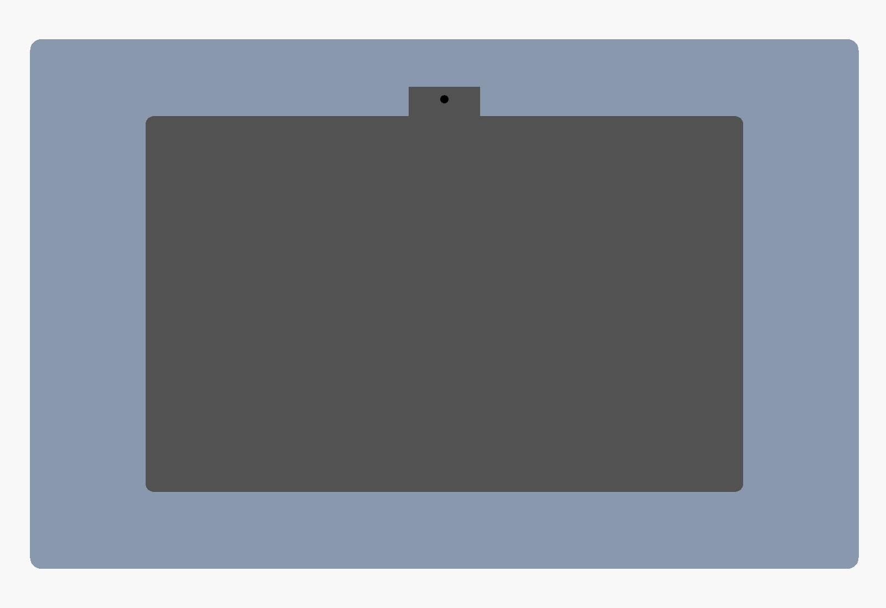

# Fire HD 10 (13th gen, TG425K) Picture-Frame Wall Mount




A 3D-printable frame that goes all the way around the tablet and holds it **horizontally**: camera at the top middle, buttons and USB-C on the **right**.


## Design
- **Two parts.** The **tray** screws to the wall and the tablet drops into it. The **bezel** is a front frame that **snaps on, with no screws**, and covers everything except the screen. It has a notch so the front camera isn't covered.
- **Hidden plug pockets.** Each side has a 22 mm pocket, the same width left and right, so the tablet sits centred in the frame. The right pocket hides a **90° USB-C plug**, which can point up or down. The pocket runs the full height of the tablet, so it works wherever the port is along that edge. The pocket floor is only 2 mm thick, and there is a 2 mm recess under the bezel, giving the plug about 13 mm of depth in total.
- **Cable exit.** The cable can leave through a slot in the bottom edge. Or, if you want to run it into the wall, through a 12 mm hole in the back (`wall_hole_d`, set it to 0 to remove the hole).
- **Snap fit.** Twelve flexible tabs on the underside of the bezel (4 top, 4 bottom, 2 on each side) sit flush in recesses in the tray's outer walls. Their barbs click into a catch groove, so nothing shows on the front.
  - **To remove the bezel:** each recess goes 1.5 mm below its tab's tip. Slip a small flat screwdriver in there and lever the tab outward, one tab at a time.
  - **To adjust the fit:** `barb` (0.9 mm) sets how tight it grips, `snap_t` (1.8 mm) how stiff each tab is, and `snap_gap` the clearance around the tab.
- Thin stop ribs at the four corners keep the tablet from sliding into the pockets. The middle of each edge stays open.
- Cut-outs in the back help with ventilation, since the tablet will be charging all the time.

## Overall size
About 304 × 195 × 16 mm (the tray is 13.2 mm deep and the bezel 3 mm).

## Files
| File | Use |
|---|---|
| `fire_hd10_frame_tray.stl`, `fire_hd10_frame_bezel.stl` | One-piece parts. These need a bed larger than 304 mm. |
| `fire_hd10_frame_tray_left/right.stl` | Tray halves, 165 × 195 mm each. They join with a lap joint at the centre, and the two centre wall screws clamp it together. |
| `fire_hd10_frame_bezel_left/right.stl` | Bezel halves, 152 × 195 mm each. They butt together at the centre, and each half has its own snap tabs on both sides of the seam. |
| `fire_hd10_wall_mount.scad` | Parametric OpenSCAD source. |

## Hardware
- 6 × 4 mm (#8) countersunk wood screws plus wall anchors, for fixing the tray to the wall.
- The bezel needs no hardware.

## Printing
**Print the bezel in PETG.** Its snap tabs need to flex, and PLA tabs can crack after a few removals. PETG also copes better with the heat from the tablet charging all the time. The tray can be PLA or PETG. Use 0.2 mm layers, 4 walls and 25 % infill. With 4 walls, the 1.8 mm tabs print solid.
- **Tray:** back side down.
- **Bezel:** front face down, with the tabs pointing up. The STLs are already flipped this way, so the visible face comes out smooth.
- No supports are needed.

## Installing
1. Put the tray halves together and screw the tray to the wall through the 6 countersunk holes in the tablet area.
2. Plug the 90° cable into the tablet and lay the cable in the right pocket. Route it out of the bottom slot or through the back hole.
3. Drop the tablet into the tray.
4. Line up the bezel and press it on until all the tabs click. If you printed it in halves, fit one half at a time.

The power and volume buttons are covered once the bezel is on. That's normal for a mounted dashboard (tap the screen to wake it). Take the bezel off if you need to press them.

## Measured dimensions
These are the owner's measurements, entered into `fire_hd10_wall_mount.scad`. The letters match [`docs/tablet_dimensions.png`](docs/tablet_dimensions.png).

| Letter | What | mm | In the model |
|---|---|---|---|
| A | Overall width | 246 | `tab_w` |
| B | Overall height (measured tight) | 165 | `tab_h` |
| C | Thickness | 8.5 | `tab_t` |
| D | Corner radius | not measured (9 assumed) | preview only |
| E/F/G/H | Black border to lit screen, all four sides | 14.7 | `screen_border` |
| J | Camera centre from left edge | 123 | `cam_x` |
| K | Camera centre from top edge | not measured | covered by the 26 mm notch |
| L | USB-C centre from bottom edge | 45.5 (approx.) | `port_y` |
| M | USB-C centre from back face | C / 2 | |
| N | Buttons start, from top edge | 19.3 | covered by the bezel |
| P | Button span | 40.2 | covered by the bezel |
| Q/R/S | 90° plug: out from edge / body length / thickness | not measured | pocket allows ≤20 / any / ≤10 |

How the model uses them:
- **Clearance:** 1.0 mm is added to the width and height, because B was a tight measurement. 0.6 mm is added to the thickness.
- **Screen opening:** the bezel covers 14.2 mm on every side. That stops 0.5 mm short of the lit screen, so no screen is hidden even if the tablet shifts in its clearance.
- **Corner stops:** they run 11 mm in from each corner. That clears the buttons (from 19.3 mm) and the port (at 45.5 mm).
- **Wall hole:** the hole for running the cable into the wall sits 30 mm below the port. A plug pointing down can feed straight into it.

## Adjusting
If your plug is wider than about 20 mm or thicker than about 10 mm, increase `pocket_w` or `pocket_relief`.

To export a part:

```bash
openscad -o fire_hd10_frame_tray_left.stl -D 'part="tray_left"' fire_hd10_wall_mount.scad
```

Parts: `tray`, `tray_left`, `tray_right`, `bezel`, `bezel_left`, `bezel_right`, `assembly`.
