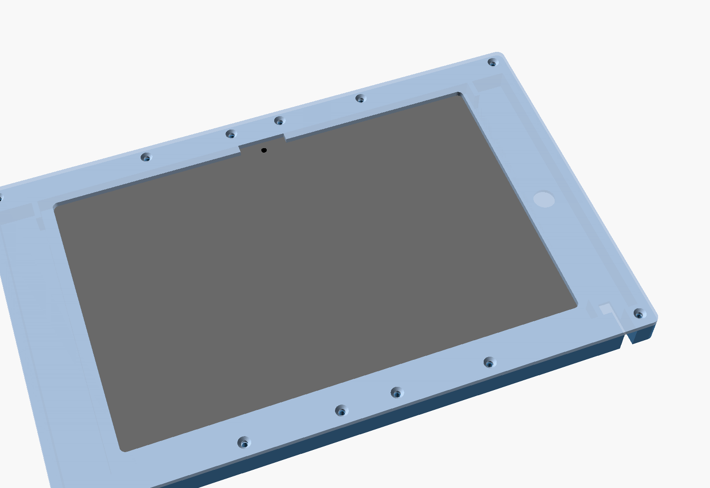
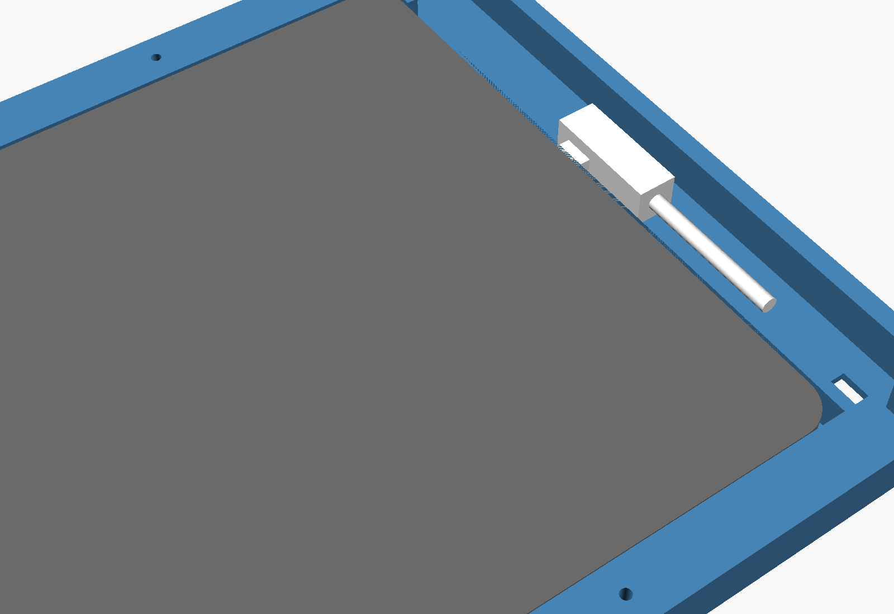

# Fire HD 10 (13th gen, TG425K) Picture-Frame Wall Mount



A 3D-printable frame that goes all the way around the tablet and holds it **horizontally**: camera at the top middle, buttons and USB-C on the **right**.



## Design
- **Two parts.** The **tray** screws to the wall and the tablet drops into it. The **bezel** is a front frame that screws on top and covers everything except the screen. It has a notch so the front camera isn't covered.
- **Hidden plug pockets.** Each side has a 22 mm pocket, the same width left and right, so the tablet sits centred in the frame. The right pocket hides a **90° USB-C plug**, which can point up or down. The pocket runs the full height of the tablet, so it works wherever the port is along that edge. The pocket floor is only 2 mm thick, and there is a 2 mm recess under the bezel, giving the plug about 13 mm of depth in total.
- **Cable exit.** The cable can leave through a slot in the bottom edge. Or, if you want to run it into the wall, through a 12 mm hole in the back (`wall_hole_d`, set it to 0 to remove the hole).
- Thin stop ribs at the four corners keep the tablet from sliding into the pockets. The middle of each edge stays open.
- Cut-outs in the back help with ventilation, since the tablet will be charging all the time.

## Overall size
About 302 × 195 × 16 mm (the tray is 13.2 mm deep and the bezel 3 mm).

## Files
| File | Use |
|---|---|
| `fire_hd10_frame_tray.stl`, `fire_hd10_frame_bezel.stl` | One-piece parts. These need a bed larger than 302 mm. |
| `fire_hd10_frame_tray_left/right.stl` | Tray halves, 164 × 195 mm each. They join with a lap joint at the centre, and the two centre wall screws clamp it together. |
| `fire_hd10_frame_bezel_left/right.stl` | Bezel halves, 151 × 195 mm each. They butt together at the centre, and each half has its own screws on both sides of the seam. |
| `fire_hd10_wall_mount.scad` | Parametric OpenSCAD source. |

## Hardware
- 6 × 4 mm (#8) countersunk wood screws plus wall anchors, for fixing the tray to the wall.
- 12 × M3 × 10–12 mm countersunk screws. They self-tap into 2.6 mm pilot holes and hold the bezel on the tray.

## Printing
PETG is recommended (the tablet gets warm while charging); PLA also works. Use 0.2 mm layers, 4 walls and 25 % infill.
- **Tray:** back side down.
- **Bezel:** front face down. The STLs are already flipped this way, so the visible face comes out smooth.
- No supports are needed.

## Installing
1. Put the tray halves together and screw the tray to the wall through the 6 countersunk holes in the tablet area.
2. Plug the 90° cable into the tablet and lay the cable in the right pocket. Route it out of the bottom slot or through the back hole.
3. Drop the tablet into the tray.
4. Screw the bezel on.

The power and volume buttons are covered once the bezel is on. That's normal for a mounted dashboard (tap the screen to wake it). Take the bezel off if you need to press them.

## Adjusting
The tablet size is set to Amazon's listed 247.1 × 165.9 × 8.6 mm, plus clearance. **Measure your tablet first.** If your plug is wider than about 20 mm or thicker than about 10 mm, increase `pocket_w` or `pocket_relief`.

To export a part:

```bash
openscad -o fire_hd10_frame_tray_left.stl -D 'part="tray_left"' fire_hd10_wall_mount.scad
```

Parts: `tray`, `tray_left`, `tray_right`, `bezel`, `bezel_left`, `bezel_right`, `assembly`.
