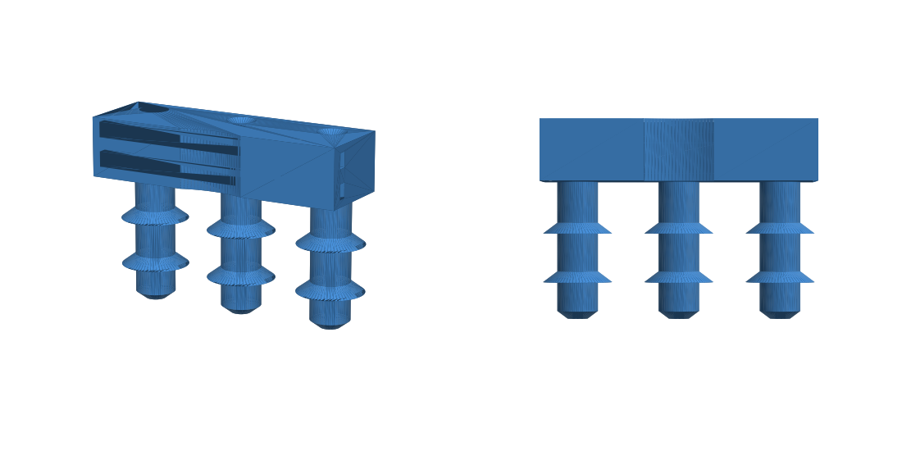

# Sump-pit probe separator

This holder is for running extension wires from a conductive leak sensor, such as the ThirdReality 3RWS18BZ, down into a sump pit. The sensor body stays dry outside the pit. Only the bare wire tips go down to the alarm level.

**Why it helps with false "wet" readings:** humidity makes condensation, and condensation forms a conductive film that links the sensor's contacts. Here each wire goes down its own leg, and the legs are 25 mm apart with an air gap between them. Each leg also has two 45° "umbrella" sheds, like the sheds on a power-line insulator. Water running down the plastic drips off a shed edge instead of reaching the tip. The bare tips can only connect through real standing water.

## Files
- `sump_probe_separator_3probe.stl` / `_2probe.stl`: ready to print
- `sump_probe_separator.scad`: parametric source (OpenSCAD)
- `build_stl.py`: rebuilds the STLs without OpenSCAD (`pip install manifold3d trimesh numpy`)

## Printing
- The STL is already oriented: top block on the bed, legs pointing up. No supports needed. A brim is optional.
- Use PETG or ASA rather than PLA, because PLA slowly degrades in a damp pit. 3 walls, 20% infill.
- Size: 67 × 24 × 65 mm (3-probe).

## Wiring
1. Find out which contacts matter. Put the sensor on a damp paper towel touching only 2 of its 3 contacts, and try each pair. Most sensors like this alarm on any pair, so 2 wires are enough. If only certain pairs trigger, wire those.
2. Solder a wire to each contact you use. Thin stranded or solid 22 AWG works; the default bore is 2.5 mm, so set `bore_d` to the wire OD + 0.4 mm. Seal the solder joints with silicone or heat-shrink so the sensor body can't false-trigger itself.
3. Push each wire down a leg and leave 5–10 mm of bare conductor sticking out of the tip.
   - Better option: push the stripped end into the bottom of the bore, then drive a short **stainless M3 screw** into the tip from below. The screw self-taps, pinches the wire, and becomes a corrosion-resistant electrode.
4. Fill the countersinks at the top with silicone so water can't wick down inside the bores.
5. Make sure the bare metal is **only** at the tips.

## Mounting
- Run two zip ties through the tunnels and around the discharge pipe. The back face has a shallow seat for 1.5" PVC (48.3 mm OD); change `pipe_d` for 1.25" (42.2) or set `pipe_seat = 0` for a flat back.
- **Height:** put the tips above the level where the pump normally turns on, roughly 2–5 cm above it, and below the inlet pipe. The tips should only get wet if the pump fails or can't keep up.
- Keep the sensor itself outside the pit, or at least out of the humid air under the lid.

## Testing
Dip the tips in a cup of water; the sensor should report wet within a few seconds. Then leave it in the pit for a few days and watch for false positives.
